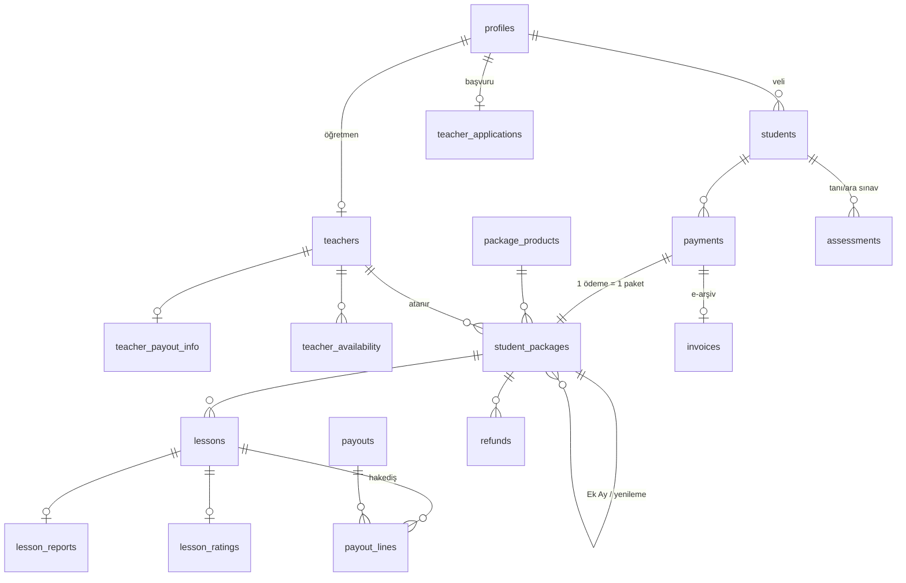

# Özel Ders Platformu — Veri Modeli ve Cursor Rehberi

> **Bu dosyayı Cursor'da projenin köküne koy** (`docs/VERI_MODELI.md`) ve her yeni istekte `@docs/VERI_MODELI.md` ile bağlam olarak ver.
> **Veritabanı CANLI:** Supabase projesi `ozelders` (ref: `jugrudmidmsubjitqqxi`, Frankfurt). Şema 24.10.2026'da uygulandı ve test edildi.
> Migration dosyaları (adlarını DEĞİŞTİRME, Supabase'deki sürüm numaralarıyla eşleşiyor):
> `supabase/migrations/20261024152641_init_ozelders_schema.sql` ve `supabase/migrations/20261024152707_lock_function_permissions.sql`

**Model:** Yönetilen pazar yeri (ajans). Veli paket satın alır, fiyatı platform belirler, öğretmene kademeli sabit ücret ödenir.
**Niş:** LGS matematik, 5–8. sınıf. Ücretsiz tanı sınavı (LGS Analitik) giriş kapısıdır.
**Stack:** Next.js 14 (App Router) + Supabase (Postgres, Auth, Storage) + PayTR + Google Meet → Daily.co/LiveKit.

---

## 1. Varlık haritası



| Grup | Tablolar | Not |
|---|---|---|
| Kimlik | `profiles`, `students` | Öğrenci için sadece ad + sınıf. Soyad, TCKN, okul TUTULMAZ |
| Öğretmen | `teacher_applications`, `teachers`, `teacher_payout_info`, `tier_rates`, `teacher_availability` | Adli sicil kopyası tutulmaz, sadece doğrulama kaydı |
| Satış | `package_products`, `pricing_settings`, `payments`, `student_packages`, `invoices` | Fiyat ve kurallar tabloda. Taksit yok. Ek Ay paketi `kind = 'ek_ay'` |
| Operasyon | `lessons`, `lesson_reports`, `lesson_ratings` | Çift rezervasyon veritabanında engellenir |
| Ölçme | `assessments`, `leads` | LGS Analitik entegrasyonu |
| Finans | `refunds`, `payout_lines`, `payouts` | Hakediş otomatik, iki kez ödeme imkânsız |
| Denetim | `audit_log`, `teacher_kpis` (view) | Kademe terfisi KPI'ları |

---

## 2. İş kuralları → nerede uygulanıyor

| Kural | Uygulandığı yer | Test |
|---|---|---|
| Ödeme webhook'u iki kez gelirse paket tek açılır | `apply_payment()` + `payments(provider, provider_ref)` unique | ✅ |
| Manipüle edilmiş tutar (ör. 1 TL) reddedilir | `apply_payment()` fiyat kontrolü | ✅ |
| Paket hakkı bitince rezervasyon yapılamaz | `book_lesson()` | ✅ |
| Aynı öğretmen / öğrenci aynı saatte iki derse giremez | `no_teacher_overlap`, `no_student_overlap` exclusion constraint | ✅ |
| 21:00 sonrası ders yok (çocuk güvenliği) | `lessons` check + `teacher_availability` check | ✅ |
| En az 2 saat önceden rezervasyon | `book_lesson()` | — |
| Veli 24 saatten önce iptal → ücretsiz | `cancel_lesson()` → `veli_iptal` | ✅ |
| Veli 24 saatten az kala iptal → ders yanar, öğretmene %50 | `cancel_lesson()` → `veli_gec_iptal` + trigger | ✅ (275 TL) |
| Öğretmen 48 saatten az kala iptal → sayaç artar | `cancel_lesson()` → `late_cancel_count_30d` | — |
| Ders tamamlanınca hakediş satırı oluşur (ders tarihindeki kademe ücreti) | `trg_lesson_payout` + `current_fee()` | ✅ (550 TL) |
| İade: kullanılan dersler liste fiyatından (1.100 TL) düşülür | `calc_refund()` | ✅ (7.600 − 3×1.100 = 4.300) |
| İlk ders güvencesi sadece öğrencinin ilk paketinde | `calc_refund()` | ✅ |
| **Öğretmen değişikliği:** ileri tarihli dersler `degisiklik_iptal` olur, hak iade edilir, ücret doğmaz | `change_teacher()` (sadece admin/service role) | ✅ |
| **Ek Ay:** sadece mevcut paketi olan öğrenci alır, aynı öğretmen otomatik atanır, eski paketin bitişinden başlar | `trg_validate_payment` + `apply_payment()` | ✅ |
| Ek Ay, paket bitişinden sonra 30 gün içinde alınabilir; sonrası yeni ana paket | `pricing_settings.ek_ay_window_days` | — |
| **Taksit yok:** her paket tek çekim | `package_products` (taksit alanı kaldırıldı) | — |
| **KVKK:** ders kayıtları 90 gün sonra silinir | `expired_recordings()` + `mark_recordings_deleted()` + günlük zamanlanmış görev | ✅ |
| Her başarılı ödeme fatura kuyruğuna girer | `apply_payment()` → `invoices` (`bekliyor`) | ✅ |
| Kademe zammı geçmiş hakedişi değiştirmez | `tier_rates` versiyonlu (`valid_from`) | — |

---

## 3. Yetki (RLS) matrisi

| Tablo | Veli | Öğretmen | Anonim | Yazma |
|---|---|---|---|---|
| `profiles` | Sadece kendi | Sadece kendi (**veli telefonunu göremez**) | ✗ | Kendi adı/telefonu. `role` kolonu kilitli |
| `students` | Kendi çocukları | Atandığı öğrenciler | ✗ | Veli |
| `teachers` | Aktif vitrin | Kendi + vitrin | ✗ | Öğretmen sadece `bio`, `video`, `display_name` |
| `payments` | Kendi | ✗ | ✗ | Sadece sunucu (service role) |
| `invoices` | Kendi | ✗ | ✗ | Sadece fatura entegrasyonu (service role) |
| `student_packages` | Kendi çocuğu | Atandığı | ✗ | Sadece fonksiyonlar |
| `lessons` | Kendi çocuğu | Kendi dersleri | ✗ | Öğretmen sadece `status` (başlamış derste) |
| `lesson_reports` | Onaylanmış olanlar | Kendi dersleri | ✗ | Öğretmen |
| `assessments` | Kendi çocuğu | Atandığı öğrenci | ✗ | Sadece LGS Analitik entegrasyonu |
| `payout_lines`, `payouts` | ✗ | Sadece kendi | ✗ | Sadece trigger / admin |
| `leads` | ✗ | ✗ | ✗ | Sunucu route'u (service role) |
| `package_products` | Okur | Okur | Okur | Admin |

**Admin:** her tabloda `admin_all` politikası var. Ama `profiles.role`, `teachers.status/tier` ve `lessons` saat alanları kolon bazında kilitli olduğundan **admin işlemleri (öğretmen onayı, kademe değişimi, öğretmen atama) sunucu tarafında service role ile yapılır** (`/app/admin/*` → server action).

---

## 4. Cursor ile yapım sırası

Her adımı ayrı istek olarak ver. Bir adım bitmeden diğerine geçme.

### Adım 0 — Kurulum
```
Veritabanı şeması Supabase'e ZATEN UYGULANDI. Migration çalıştırma, db push yapma.
1. Supabase istemcileri: tarayıcı ve sunucu ayrı (@supabase/ssr), service role sadece
   sunucuda ("server-only" paketiyle).
2. `npx supabase gen types typescript --project-id jugrudmidmsubjitqqxi > lib/database.types.ts`
   ile tipleri üret ve istemcilere bağla.
3. Boş ana sayfa: başlık, kısa açıklama, "Ücretsiz Tanı Sınavı" butonu.
Hiçbir tabloyu ya da politikayı değiştirme. Bitince dur.
```

### Adım 1 — Kimlik ve veli kaydı
```
@docs/VERI_MODELI.md Supabase Auth ile e-posta + SMS OTP girişi yap.
Kayıtta profiles satırını role='veli' ile oluştur (KVKK aydınlatma onayı zorunlu,
pazarlama izni ayrı onay kutusu). Veli panelinde çocuk ekleme formu: sadece ad ve sınıf.
Service role anahtarını istemci tarafında ASLA kullanma.
```

### Adım 2 — Öğretmen başvuru hunisi
```
@docs/VERI_MODELI.md teacher_applications için 7 adımlı başvuru akışı:
form (statü + devlet memuru değilim beyanı) → branş testi (20 soru, eşik %85) →
90 sn tanıtım videosu → demo ders randevusu → belge doğrulama → sözleşme → oryantasyon.
Adli sicil belgesinin KOPYASINI saklama; admin barkodu doğrulayınca sadece
criminal_record_verified_at ve verified_by alanlarını doldur.
Admin onay ekranı server action + service role ile çalışsın.
```

### Adım 3 — Paket satışı ve ödeme (PayTR)
```
@docs/VERI_MODELI.md PayTR ile ödeme (iFrame API): sunucu payments satırını 'beklemede' oluşturur,
tutarı package_products.price'tan alır (istemciden gelen tutara güvenme).
Webhook route'u imzayı doğrular, sonra apply_payment(provider, ref, payload) RPC'sini
service role ile çağırır. Webhook'un iki kez gelmesi senaryosunu test et.
```

### Adım 4 — Takvim ve rezervasyon
```
@docs/VERI_MODELI.md Öğretmen teacher_availability üzerinden haftalık müsaitlik girer.
Veli boş slotları görür ve book_lesson(package_id, starts_at) RPC'si ile rezervasyon yapar.
Çakışma hatası (exclusion constraint) gelirse kullanıcıya "Bu saat az önce doldu" göster.
Tüm saatler Europe/Istanbul. İptal butonu cancel_lesson() çağırır ve öncesinde
"24 saatten az kaldı, ders hakkınızdan düşecek" uyarısı gösterir.
```

### Adım 5 — Ders sonrası rapor (AI)
```
@docs/VERI_MODELI.md Öğretmen dersi 'tamamlandi' işaretler ve 3 maddelik not girer.
Sunucu tarafında Claude API ile veliye yönelik kısa özet + ödev üretilir, ai_summary'ye yazılır.
Öğretmen önizleyip onaylayınca visible_to_parent = true olur ve veliye bildirim gider.
```

### Adım 5b — Ek Ay, öğretmen değişikliği, kayıt silme
```
@docs/VERI_MODELI.md
1) Veli panelinde paket bitimine 7 gün kala ve bittikten sonraki 30 gün boyunca "Ek Ay al" kartı göster
   (EK_AY_4 / EK_AY_8). Ödeme oluştururken renews_package_id = mevcut paket. Doğrulama veritabanı
   trigger'ında; istemciye sadece hata mesajını göster.
2) Admin panelinde "Öğretmen değiştir": change_teacher(package_id, new_teacher_id, reason) çağır,
   dönen sayı kadar dersin yeniden planlanması için veliye bildirim gönder.
3) Supabase Edge Function + günlük zamanlanmış görev: expired_recordings() → Storage'dan sil →
   mark_recordings_deleted(ids). Sadece service role.
```

### Adım 6 — İade, hakediş, KPI
```
@docs/VERI_MODELI.md Veli panelinde calc_refund() sonucunu şeffaf döküm olarak göster.
Admin panelinde: dönem bazlı hakediş listesi (payout_lines → payouts),
teacher_kpis görünümünden kademe terfi önerileri.
```

### Her adımdan sonra güvenlik turu
```
Bu adımda yazdığın kodu bir saldırgan gözüyle incele:
1) Başka bir velinin verisine erişilebilir mi?
2) İstemciden gelen tutar, rol veya kimlik bilgisine güvenilen yer var mı?
3) Service role anahtarı istemci paketine sızıyor mu?
4) Aynı işlem iki kez tetiklenirse ne olur?
Bulgularını listele, sonra düzelt.
```

---

## 5. Doğrulanan senaryolar (PostgreSQL 16, Supabase auth taklidi)

| # | Senaryo | Sonuç |
|---|---|---|
| T1 | Webhook 2 kez çağrıldı | 1 paket ✅ |
| T2 | 7.600 TL'lik paket 1 TL ile ödenmeye çalışıldı | Reddedildi ✅ |
| T3 | Veli `apply_payment` çağırdı | Yetki yok ✅ |
| T4 | 4 derslik pakette 5. ders / başka velinin paketi | Reddedildi ✅ |
| T5 | Aynı öğretmene çakışan saat / 21:30 dersi | Reddedildi ✅ |
| T6 | Öğretmen veli profilini sorguladı / ders saatini, kademesini değiştirmeye çalıştı | 0 satır / yetki yok ✅ |
| T7 | Veli kendini admin yapmaya çalıştı | Yetki yok, ad güncellemesi çalıştı ✅ |
| T8 | 10 saat kala iptal / 3+ gün kala iptal | `veli_gec_iptal` + 275 TL hakediş / `veli_iptal` ✅ |
| T9 | Öğretmen geçmiş dersi tamamladı (K2) | 550 TL hakediş ✅ |
| T10 | Başka velinin iade hesabını görmeye çalışma | Yetki yok ✅ |
| T12 | Anonim kullanıcı | Sadece ürün vitrinini görür ✅ |
| T13 | İkinci pakette 3 ders sonrası iade | 4.300 TL, güvence uygulanmadı ✅ |
| T14 | Ek Ay başka öğrencinin paketine bağlanmaya çalışıldı / ana pakette kullanıldı | Reddedildi ✅ |
| T15 | Doğru Ek Ay alımı | Aynı öğretmen, önceki pakete bağlı, bitişten başlar, 30 gün, fatura kuyruğunda ✅ |
| T16 | Öğretmen değişikliği (2 ileri tarihli ders) | Veli ve anonim çağıramaz. 2 ders iptal, hak 3→1'e geri döndü, ücret doğmadı, aynı saat yeni öğretmenle planlandı ✅ |
| T17 | 100 günlük ders kaydı | Silme listesine girdi, işaretlendi. Veli fonksiyonu çağıramaz ✅ |
| T18 | Fatura görünürlüğü | Veli sadece kendi faturalarını görür ✅ |

---

## 6. Alınan kararlar

| # | Konu | Karar | Şemadaki karşılığı |
|---|---|---|---|
| 1 | Öğretmen değişikliği | Admin değiştirir, ileri tarihli dersler iptal edilip yeniden planlanır | `change_teacher()`, `degisiklik_iptal` statüsü |
| 2 | Paket uzatma | Ücretsiz uzatma yok. Veli **Ek Ay** paketi satın alır (haftada 1: 4.000 TL, haftada 2: 7.200 TL) | `package_products.kind = 'ek_ay'`, `payments.renews_package_id` |
| 3 | Taksit | Yok, tek çekim | `installments` alanı kaldırıldı |
| 4 | Ders kaydı saklama | 90 gün, sonra otomatik silme | `recording_retention_days`, `expired_recordings()` |
| 5 | Fatura | **Bekliyor:** ödeme altyapısı PayTR, e-arşiv entegratörü muhasebeciyle netleşecek | `invoices` tablosu hazır, her ödeme kuyruğa giriyor |
| 6 | Öğretmen ödemesi | **Bekliyor:** muhasebeci / YMM kararı. Seçenekler: `smm`, `bordro`, `stopajli` | `teacher_payout_info.payment_model` |

**Kayıt dışı ödeme seçeneği şemada bilinçli olarak yok.** Her hakediş satırı (`payout_lines`) belgeli bir ödemeye bağlanmak üzere tasarlandı.

## 7. Kesin kurallar (Cursor'a her seferinde hatırlat)

- RLS'yi **asla** kapatma, `using (true)` politikası yazma.
- Tutar, rol, öğretmen ataması **asla** istemciden alınmaz.
- Service role anahtarı sadece sunucuda (`server-only`), `.env.local`'da, repo private.
- Çocuk verisi minimum: ad + sınıf. Ek alan eklemeden önce sor.
- Tüm zamanlar `timestamptz`, gösterim `Europe/Istanbul`.
- Fiyat ve kurallar `package_products`, `pricing_settings`, `tier_rates` tablolarında; kodda sabit sayı yok.

---

## 8. Sınav modülü (ücretsiz denemeler)

**Tablolar:** `exams` (sınav, kitapçık bağlantısı, süre, durum) · `exam_sections` (Matematik, Fen; soru sayısı) · `exam_questions` (cevap anahtarı + konu) · `exam_attempts` (öğrencinin cevapları, sonuç, toplam net).

**Güvenlik kuralları**
- `exam_questions` (cevap anahtarı) **hiçbir istemciye açık değil**. Puanlama sadece `submit_exam_attempt()` içinde, veritabanında yapılır.
- Kitapçık PDF'i **barındırılmaz**; `booklet_url` resmi kaynağa yeni sekmede açılır.
- Kayıtsız kullanıcı deneme çözebilir. Sonuca yalnızca kendisine verilen gizli `access_token` ile erişir (`/deneme/[slug]/sonuc/[id]?t=...`).
- Net, sıralama herkese; **konu konu rapor ve soru soru cevaplar yalnızca giriş yapmış kullanıcıya** (veli hesabı kayıt teşviki).
- Giriş yapan kullanıcı kayıtsız çözdüğü denemeyi `claim_exam_attempt()` ile hesabına bağlar.
- Ad alanı sadece harf ve boşluk kabul eder, 40 karakterle sınırlı; soyad istenmez.

**Akış:** `/deneme` → `/deneme/[slug]` (kitapçığı aç, süreyi başlat, optik form; cevaplar tarayıcıda saklanır) → `/deneme/[slug]/sonuc/[id]`.

**Net:** doğru − yanlış / 3 (LGS kuralı).

**İlk sınav:** `2026-lgs-sayisal` (A kitapçığı, 40 soru, 80 dk). Cevap anahtarı kitapçığın son sayfasından alındı ve doğrulandı. Konular ünite düzeyinde yaklaşık eşleştirmedir; admin ekranında düzeltilecek.

**Sıradaki:** admin ekranı (PDF yükle → cevap anahtarı ve konu önerisi → kontrol tablosu → yayınla).

### 8.x Yönetim ekranı (sınavlar)
- `/admin/sinavlar`: tüm sınavlar (durum, soru, çözen, ort. net).
- `/admin/sinavlar/yeni`: PDF tarayıcıda okunur (unpdf), sunucuya yüklenmez. Cevap anahtarı + konu önerileri tabloya dolar, admin kontrol eder → `admin_create_exam` ile **taslak** oluşur.
- `/admin/sinavlar/[id]`: bilgiler, cevap ve konu düzenleme, Yayınla / Yayından kaldır / Arşiv / Sil (yalnız çözülmemiş taslak). Cevap anahtarı değişirse eski sonuçlar yeniden puanlanmaz.
- Admin girişinde üst menüde "Yönetim" bağlantısı görünür.
- Soru resimleri (kendi denemelerimiz): `exam_question_images` + herkese açık `exam-images` bucket (yazma yalnız admin, 1,5 MB, webp/png/jpeg). Tarayıcı resmi 1400 px WebP'ye küçültür. Yayın kuralı: kitapçık bağlantısı **ya da** tüm soruların resmi.
- Öğrenci ekranı: resmi kitapçıkta masaüstünde "Kitapçığı yanda aç" (iframe, dosya bizde durmaz); resimli denemede soru kartları, süre başlayınca açılır.
- PDF'ten soru resmi (kendi denemelerimiz): düzenleme ekranında "PDF'ten soru resimleri". Tarayıcıda soru numaralarına göre kesilir (2 sütun destekli, kapak/yönerge listeleri atlanır, sütun çizgileri kırpılır) ya da "her sayfa bir soru". Önizlemede seçilenler yüklenir; PDF sunucuya gitmez. Tek tek "Resim ekle / Değiştir" de duruyor.
- **Kitapçık kaynağı (öncelik sırasıyla):** `exams.booklet_path` (kendi denememiz; `exam-booklets` bucket, 30 MB, yazma yalnız admin) → `booklet_url` (resmi sınav, kendi sitesinden) → soru resimleri. Masaüstünde kitapçık varsayılan olarak cevap kâğıdının yanında açılır; telefonda yeni sekme. "Yeni sınav" ekranında cevap anahtarı olmayan PDF kendi deneme sayılır: soru sayısı numaralardan bulunur, sınav oluşturulunca PDF otomatik yüklenir.
- **Lise / YKS (2026-10-25):** `exams.kind` (lgs, tyt, ayt, ydt, okul, diger), `option_count` (4|5), `wrong_penalty` (0|3|4). Puanlama sınavdan okur: LGS 4 şık / 3Y1D, YKS 5 şık / 4Y1D, okul ceza yok. 4 şıklı sınavda E cevabı reddedilir, öğrencinin E'si boş sayılır. Sınıflar 5–12 (12 = 12. sınıf / mezun). Ders listesi ve tür ayarları `lib/exam-kinds.ts`. Deneme listesinde Ortaokul / Lise / YKS sekmeleri (en az iki grupta sınav varsa).
